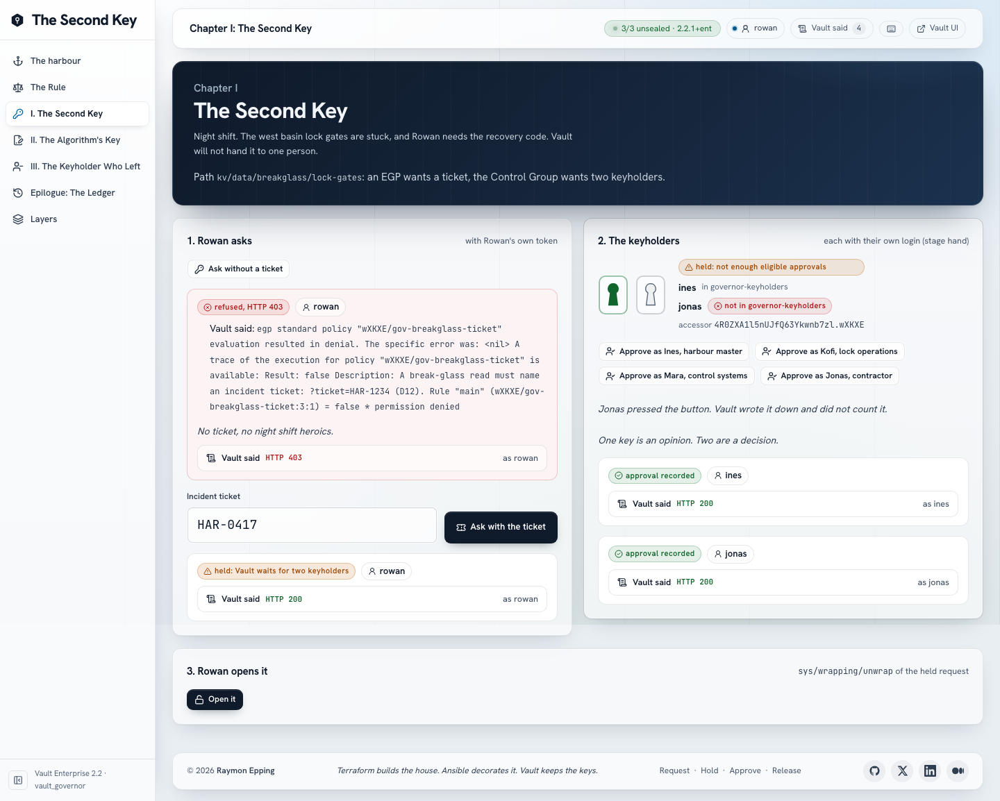

# vault_governor: The Second Key

Governance as code on Vault Enterprise 2.2, on one Mac with Podman. Terraform
writes the rules; Vault makes people follow them: a risky action waits until
two of three keyholders approve, a Sentinel policy refuses a request that
lacks its governance context, and the audit log proves who did what. Three
chapters, played from a console: a break-glass read, a change of a signing
key's algorithm to ML-DSA, and a keyholder who leaves while a request waits.

> **Terraform builds the house. Ansible decorates it. Vault keeps the keys.
> Make is the front door.**



## What it proves, and what it only illustrates

**Proves:** a Control Group factor holds a request until two distinct
members of a named group approve; one approval is not enough; an approver
outside the group is listed and not counted; a Sentinel EGP refuses a
request before any approval (no ticket, a forbidden algorithm); the
algorithm change of a Transit key goes through the same approval and both
signatures stay verifiable, by Vault and by a plain Node verifier; SCIM
changes the roster Vault evaluates, and the lab measures what that changes;
an approval lives as long as the approver's token; the audit log holds the
whole night. Every claim is measured in [docs/capabilities.md](docs/capabilities.md).

**Illustrates only:** the harbour, the people and the recovery code are
invented; one local SCIM client stands in for an identity platform; one
presenter plays several people (the stage-hand shortcut,
[docs/security-model.md](docs/security-model.md)); one Mac is not production.

## The story

Kestrel Harbour Authority runs its lock gates from one control system.

| Chapter | What happens | Vault feature |
| --- | --- | --- |
| Prologue: The Rule | The rule is read before anything runs | ACL policies, EGPs, `sys/capabilities-self` |
| I. The Second Key | Rowan, the duty engineer, needs the recovery code at night | KV read, EGP (ticket), Control Group (2 of 3), response wrapping |
| II. The Algorithm's Second Key | The release-signing key changes from ECDSA P-256 to ML-DSA-65 | Transit crypto agility behind the same Control Group, EGP (target) |
| III. The Keyholder Who Left | HR offboards Mara through SCIM while a request waits | SCIM (users, group, `active`), Control Group evaluation |
| Epilogue: The Ledger | The night, replayed | File audit devices on three nodes |

Full story: [docs/STORY.md](docs/STORY.md).

## Prerequisites

- macOS on Apple Silicon, Podman 6 with a running machine (8 GiB or more).
  Disk: about 1.2 GB for the images and volumes (measured 2026-11-11:
  vault-enterprise 571 MB, the api and web images 234 MB, node, nginx and
  alpine 241 MB, the volumes 140 MB), plus Playwright's Chromium for
  `make test-ui`.
- Terraform 1.14, ansible-core 2.21, Node 24 or later, `jq`, `openssl`,
  `shellcheck` (for `make lint`).
- A Vault Enterprise licence with Namespaces, Control Groups and Sentinel:
  `VAULT_LICENSE` in `.env`.

## First run

```bash
make env-init          # .env from .env.example; put VAULT_LICENSE in it
make license           # installs it to .secrets/vault/vault.hclic, never printed
make lab               # every phase, then the gates (about two minutes)
make people-copy-password U=rowan
```

Then open the console at <https://localhost:13901/> and sign in as `rowan`.
The lab CA is in no browser's trust store: `make trust-root` adds it to the
macOS keychain (sudo), or accept the warning.

`make up` on a lab that was never built runs `make lab` itself, so the
Lab Index (vault_lab_index) Start button works from nothing.

## Daily

```bash
make up                # or the Lab Index's Start: everything back, volumes kept
make down              # or its Stop: every container stops, every volume stays
make show-ready        # five minutes before a talk: up, fresh stage, verify
make stage-reset CONFIRM=yes   # after a rehearsal: roster, signing key back to v1
make doctor            # what is wrong, and which command fixes it
```

## Checks

| Command | What it proves |
| --- | --- |
| `make verify` | 72 checks: the cluster, the platform, the stage, the app, the console, the token boundary, drift, idempotency, a secret scan and `make rehearsal` |
| `make rehearsal` | 50 cases through the console: every chapter and every way it must fail |
| `make boundary` | 66 checks: each tool token and each person may do their job and nothing else |
| `make test-ui` | 24 Playwright tests: the three chapters, axe WCAG 2.1 AA on every page (desktop and phone), TLS and CSP |
| `make probe` | 83 cases in a scratch namespace: what Vault 2.2.1 actually does |
| `make test-unit`, `make lint` | unit tests and static checks, no stack needed |

## Ports (127.0.0.1)

| Service | Address |
| --- | --- |
| Console | <https://localhost:13901/> |
| API | <http://127.0.0.1:13900/api/health> |
| vault-1 to vault-3 | <https://localhost:19401/ui>, 19402, 19403 |
| vault-s (the seal Vault) | <https://localhost:19400> |

Every container, compose project and volume carries the prefix `vgov-`.

## Where things are

- `Makefile`, `scripts/`: every operation; `scripts/phases.txt` is the only
  phase list.
- `terraform/vault-seal`, `terraform/vault-platform`: the declared structure
  (namespace `governor`, policies, EGPs, the SCIM client).
- `ansible/`: order and moment (init, tokens, people, stage, validate).
- `config/story.json`, `config/roster.json` (the HR source of the SCIM
  client), `config/defaults.conf`.
- `vault/`: server HCL, bootstrap policies, Sentinel EGPs.
- `api/` (Node 24, no dependencies), `web/` (React 19 + Vite, Vault daylight
  glass), `e2e/` (Playwright).
- Docs: [architecture](docs/architecture.md), [operations](docs/operations.md),
  [security model](docs/security-model.md), [ownership](docs/ownership.md),
  [capabilities](docs/capabilities.md), [design](DESIGN.md),
  [state](docs/STATE.md).

## Licence

[GPL-3.0](LICENSE).
